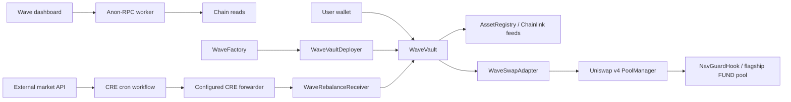

# Wave Protocol

Token baskets, in balance. A Sepolia-oriented demo with independent ERC-20 basket vaults, Uniswap v4 swaps and NAV-sensitive hook fees, Chainlink CRE rebalance automation, and Anon-RPC browser reads.

## Run the complete local demo

Requirements: Node 22.12+ or Node 24, npm, and network access for the first Solidity/Javy compiler downloads. Foundry binaries and Bun are installed as project dependencies.

```sh
npm ci
npm run demo
```

Open **http://127.0.0.1:5173**. The runner starts a fresh Anvil chain on port 8545, deploys the contracts, seeds three asset pools plus a flagship hook pool, writes a local deployment manifest, and starts Vite. Connect the demo wallet to use Anvil's unlocked test account when no injected wallet is installed. With an injected wallet, connect it to the displayed local network using an Anvil test account. Ctrl-C stops the owned node and dashboard. The chain is disposable; restarting discards previous demo positions. The runner refuses to take over an occupied port 8545.

The local network uses **direct, counted loopback reads**, a public Anvil test key, mock tokens, mock price feeds, and a mock forwarder. None of this is presented as a private or production deployment. The deployer initially receives faucet tokens and funds the flagship basket and pools; its hourly faucet claim will already be used.

In a second terminal, exercise the local forwarder/receiver path:

```sh
npm run rebalance:local
```

This submits a bounded, deterministic report fixture and creates an on-chain history record. **It is not a Chainlink CRE simulation.** Repeated execution is subject to report freshness, monotonic observations, and the five-minute rebalance interval.

## Verify

```sh
npm run typecheck
npm run test
npm run build
npm run build:workflow
npm run check:contracts
```

Tests cover the public create/deposit/redeem lifecycle, real local v4 PoolManager settlement, fees, stale/invalid feeds, timelocks, allocation and turnover guards, receiver authentication/replay, deterministic strategy bounds, and fail-closed privacy routing. Production contract bytecode is checked against EIP-170. Foundry's larger script/test harness size allowance does not relax deployed contract limits.

`npm run build` builds the static dashboard. `npm run build:workflow` compiles the CRE entry point to WASM using Bun/Javy. `npm run dev` starts only the dashboard. Without a deployment manifest, the UI shows an unconfigured state and offers no transactions. Build and test artifacts are ignored by Git.

## Architecture



The factory uses a dedicated, factory-only deployer to keep both factory and vault deployment bytecode within Ethereum limits. Vaults are ordinary contracts, not proxies. No backend, indexer, database, or server-side wallet is used by the app.

- Contracts: [vault](contracts/src/WaveVault.sol), [factory/deployer](contracts/src/WaveFactory.sol), [registry](contracts/src/AssetRegistry.sol).
- Uniswap: [swap settlement](contracts/src/WaveSwapAdapter.sol), [NAV guard](contracts/src/NavGuardHook.sol), [pool deployment](contracts/script/DeployDemo.s.sol).
- Chainlink: [workflow](cre/src/workflow.ts), [bounded strategy](cre/src/strategy.ts), [receiver](contracts/src/WaveRebalanceReceiver.sol).
- Privacy: [worker and public client](web/src/lib/chain.ts), [traffic accounting](web/src/lib/privacy.ts).
- Product contract: [Wave Protocol specification](WAVE_PROTOCOL_SPEC.md).

## Economic and configuration decisions

- Up to four distinct allowlisted assets; positive target weights total 10,000 bps, at most 5,000 bps each. A settlement-token component is supported without self-swapping.
- Six-decimal mock USDC settlement, eighteen-decimal shares, normalized eighteen-decimal USD prices; WBTC uses eight token decimals. USDC/USD is valued through its feed rather than assumed to be a permanent dollar peg.
- Initial share price is one settlement token per share. Minimum seed is 10 mUSDC; 1,000 smallest share units are permanently locked from the seed entitlement. Later deposits use measured value added and crystallize pre-existing gains before participation.
- A 10 bps withdrawal fee applies to both exits. Settlement exits pay treasury in mUSDC. In-kind exits transfer fee shares to the treasury and burn only net shares against pre-burn supply.
- Creator performance fees range from 0–2,000 bps. They mint dilution-adjusted shares only above a fund-level high-water mark. **In-kind exits never crystallize outstanding performance fees**, even with healthy feeds, to preserve a price-independent exit. This can let a holder avoid uncrystallized creator fees; the demo does not implement per-investor equalization or production fee fairness.
- Manual proposals replace previous pending proposals and may be cancelled by the creator. Automation pauses while a proposal exists. Permissionless execution after ten minutes activates target weights without trading and starts a five-minute cooldown. Later CRE reports may change those targets again within vault bounds.
- Turnover is half the absolute difference between actual and proposed weights, including residual mUSDC as a cash leg; odd basis points round up. Actual weights use current oracle-valued holdings. Rebalances cap turnover at 20%, require a five-minute interval, cap per-swap and total NAV loss at 1%, and enforce the asset rules again on-chain.
- Strategy: tilt current target weights using external 24-hour market changes clipped to ±50%, normalize under 50% asset caps, interpolate toward the result to respect turnover, and skip changes below 300 bps turnover. A proposal that cannot meet all bounds is skipped. No LLM dependency is included. At most the first three registered baskets are inspected per run.
- Hook fees: 500 v4 fee units (0.05%) within a ±1% NAV band; outside it, 500 toward NAV and 10,000 (1%) away. Direction and deviation are evaluated before the trade, including trades that cross NAV. Pool spot measures deviation; underlying holdings and feeds supply reference NAV. Only the flagship pool is hooked.
- Recent history retains 32 records with monotonic IDs. Expired IDs revert; older events remain queryable from the deployment block with adaptive log pagination.
- Registry, pool configuration, and factory rebalancer are administered through two-step ownership. These are trusted demo administration roles and can affect valuation and trading. Mock-token faucets are public and hourly limited; mock feeds are owner-controlled. This software is unaudited and testnet-only.

## Configure Sepolia

A funded Sepolia deployer and a CRE account are external prerequisites. No live deployment, verification transaction, or CLI broadcast is claimed by the local demo.

1. Create a Foundry keystore with the official Foundry tooling. Keep keys out of source and frontend environment files. Populate the deployment environment from the names in `contracts/.env.example`, using current official contract/feed/forwarder addresses. The script reads feed metadata and refuses unhealthy feed values before pool creation. Verify heartbeats/bounds and adequate gas before broadcasting.
2. From the contracts directory, run the deployment with the funded keystore:

   ```sh
   forge script script/DeployDemo.s.sol:DeployDemo --rpc-url "$SEPOLIA_RPC_URL" --account deployer --broadcast --verify
   ```

   `DEPLOYER_ADDRESS` must match the keystore. No raw deployer key is needed for Sepolia. The script writes the deployment manifest; archive addresses, transaction receipts, and explorer verification results. The local deployment path also uses this script, but uses only the public disposable Anvil key.
3. Convert the generated manifest and configure the browser and CRE addresses:

   ```sh
   node scripts/manifest.mjs deployments/demo.json web/public/deployment.sepolia.json https://ethereum-sepolia-rpc.publicnode.com
   VITE_DEPLOYMENT_URL=/deployment.sepolia.json npm run build
   ```

   The converter also populates CRE factory/receiver addresses and token-to-market-ID mappings for Sepolia. The public browser RPC must not contain private credentials. Configure an independently checked worker specifier/bootstrap URL when overriding defaults.
4. Install/login to the official CRE CLI, configure its funded simulation wallet using its supported secret mechanism, and run from the workflow directory:

   ```sh
   cd cre
   cre workflow simulate . --target staging-settings --non-interactive --trigger-index 0 --broadcast
   ```

   Check the current CLI configuration conventions against the installed version. Observe a successful, nonzero broadcast transaction addressed to the forwarder, a successful receiver execution, and a new vault history entry. If market drift is below threshold, the workflow correctly skips; do not lower bounds or invent market data to claim a successful automated trade.

**CRE modes:** current simulation mock forwarders omit workflow metadata. Set `CRE_SIMULATION=true` for a disposable Sepolia simulation receiver. It authenticates the caller and keeps all vault/report bounds but does not claim workflow identity authentication. The immutable flag only permits Sepolia/local deployment. For an authenticated workflow receiver, deploy a new instance with simulation disabled, the correct forwarder, and actual workflow ID/author/encoded name; do not promote a simulation contract as production-ready. Workflow name encoding follows the CRE engine: take the first ten lowercase hex characters of SHA256(name), encode those characters as bytes10, then pad the environment value to bytes32.

## Privacy traffic statement

On Sepolia, app-originated contract reads, logs, blocks, balances, simulations, and receipt polling use one Anon-RPC worker through the public client's transport. The default immutable Nox specifier comes from the source plan and is configurable. The harness verifies worker bytes by hash and supplies its sandbox; fonts are self-hosted.

The meter counts individual JSON-RPC methods, including batch members. Successful coverage is `anon / (anon + bootstrap + explicit-direct)`. Attempts/errors are shown separately. It never inflates success counts using failed requests. Bootstrap is direct and metered. Wallet-side RPC and transaction broadcasts are separate and outside this meter; CRE is off-browser. Local Anvil reads are explicitly direct and counted. Page reloads reset session counters.

A failed private read never silently uses a public fallback. The single-read direct action authorizes only its specific block request and makes the badge amber. The private worker has a sixty-second startup deadline. A full Sepolia lifecycle must still be measured against the spec's <10s startup and ≥95% coverage targets; a successful worker-only probe is not full-session acceptance evidence.

## Delivery status and remaining evidence

The local chain and browser flows have been exercised. See [verification notes](docs/VERIFICATION.md) for actual evidence and limitations. Sepolia deployment/fork checks, real CRE CLI broadcast, event eligibility, partner forms, a public remote, a demo video, and submission are still external delivery steps. No tracker is configured. No form, issue, remote repository, or hackathon submission has been published.

The SDK currently pins a Zod 3 dependency with a reported high-severity collection-size advisory. Vitest was upgraded to remove the critical test-runner advisories found during setup. `npm audit` should be revisited before any production use; do not force-upgrade SDK internals across major versions without compatibility verification.

Own application source is MIT licensed. Third-party dependencies retain their licenses, including Uniswap's published licenses. See [AI attribution](AI_ATTRIBUTION.md) and [Uniswap feedback](FEEDBACK.md).

## Integration references

- [Uniswap unlock callbacks and settlement](https://developers.uniswap.org/docs/protocols/v4/guides/unlock-callback-and-deltas)
- [Chainlink consumer contracts, metadata, and simulation limitations](https://docs.chain.link/cre/guides/workflow/using-evm-client/onchain-write/building-consumer-contracts)
- [CRE TypeScript SDK](https://github.com/smartcontractkit/cre-sdk-typescript)
- [Anon-RPC specification](https://ethereum.github.io/anon-rpc/spec/)
